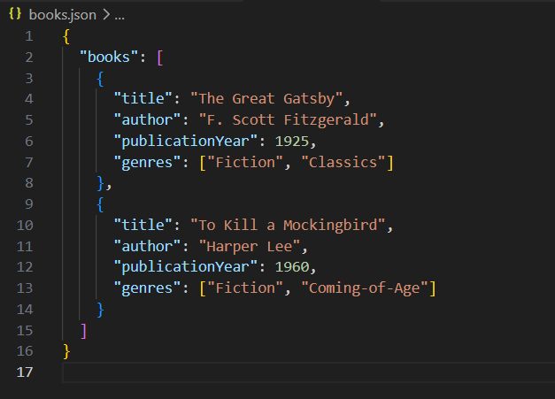
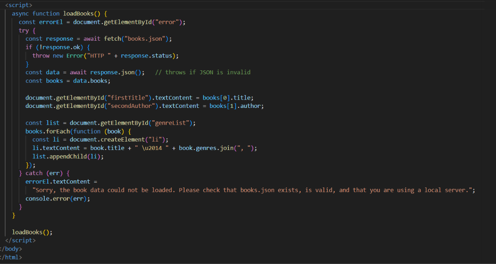
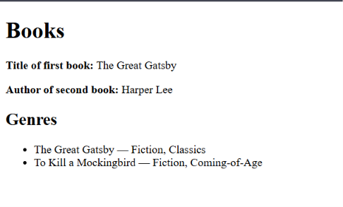
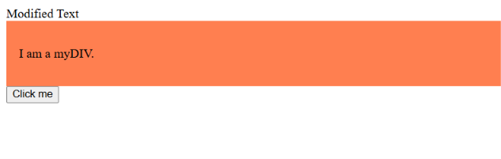
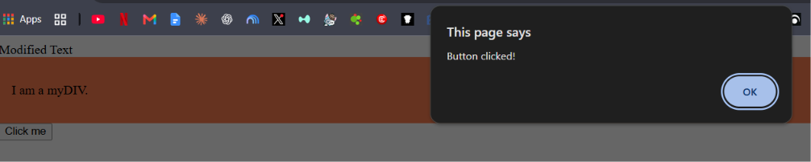

# BIC21203 Web Development - Lab 4b: Client-Side Scripting (JSON and jQuery)

**Name:** Syafiq
**Student ID:** CI250113
**Programme:** Bachelor of Computer Science (Information Security), FSKTM, UTHM
**Session:** 2026/2027

## Overview

| File | Task | Key concepts |
| --- | --- | --- |
| `books.json` | Q1 - JSON dataset | Top-level `books` array, strings, number, genre arrays |
| `books.html` | Q2 - Retrieve and display JSON | `fetch()`, `async/await`, `textContent`, error handling |
| `jquery-dom.html` | Q3 - Native JS vs jQuery | `.text()`, `.addClass()`, `.on("click", ...)` |

## Setup and how to run

`books.html` loads `books.json` with `fetch()`, so it **must be served by a local web server**. It will not work when opened with `file://`.

1. Install [VS Code](https://code.visualstudio.com/) and the **Live Server** extension.
2. Open this folder in VS Code.
3. Right-click `books.html` and choose **Open with Live Server**.
4. Open `jquery-dom.html` the same way. It needs internet access to load jQuery from the CDN.

Alternative using Python:

```bash
python -m http.server 8000
# then visit http://localhost:8000/books.html
```

## Question 1 - books.json

`books.json` has one top-level object with a `books` array. Each book has `title` and `author` (strings), `publicationYear` (number) and `genres` (array of strings). Keys use double quotes and there are no trailing commas, so the file is valid JSON.



## Question 2 - books.html

`fetch("books.json")` returns a response, which is checked with `response.ok` and parsed with `response.json()`. The page shows the title of the first book, the author of the second book and the genres of each book, using `textContent` and `createElement()`. A `try/catch` block handles a failed request or invalid JSON.

**Code**



**Output (served through Live Server)**



**Error handling** - the message shown when `books.json` cannot be loaded:


## Question 3 - jquery-dom.html

Three native JavaScript operations were converted to jQuery. The code runs inside `$(function () { ... })` so the DOM is ready first.

| Operation | Native JavaScript | jQuery |
| --- | --- | --- |
| (a) Change text | `textContent = "Modified Text"` | `.text("Modified Text")` |
| (b) Add a class | `classList.add("myStyle")` | `.addClass("myStyle")` |
| (c) Click event | `addEventListener("click", ...)` | `.on("click", ...)` |

jQuery 4.0.0 (full build) is loaded from `https://code.jquery.com/jquery-4.0.0.min.js`.

The script runs when the page is ready, so the text and style change on load. The alert appears only after the button is clicked.

| After page load (text changed, `myStyle` applied) | After clicking the button (alert shown) |
| --- | --- |
|  |  |

## Native JavaScript vs jQuery

- **Advantage of native JavaScript:** it needs no extra library download, so pages load faster, and it uses modern browser features directly.
- **Why a project may still use jQuery:** an older project may already depend on jQuery code and plugins, and rewriting it would take time and could introduce new bugs.
