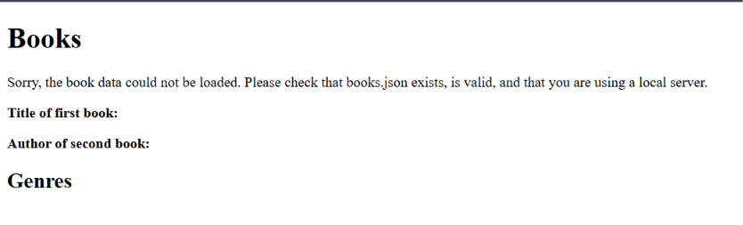

# BIC21203 Web Development - Lab 4b: Client-Side Scripting (JSON and jQuery)

**Name:** Syafiq
**Student ID:** CI250113
**Programme:** Bachelor of Computer Science (Information Security), FSKTM, UTHM
**Session:** 2026/2027

## Overview

| File | Task | Key concepts |
| --- | --- | --- |
| `books.json` | Q1 - JSON dataset | Top-level `books` array, strings, number, genre arrays |
| `books.html` | Q2 - Retrieve and display JSON | `fetch()`, `async/await`, `textContent`, error handling |
| `jquery-dom.html` | Q3 - Native JS vs jQuery | `.text()`, `.addClass()`, `.on("click", ...)` |

## Setup and how to run

`books.html` loads `books.json` with `fetch()`, so it **must be served by a local web server**. It will not work when opened with `file://`.

1. Install [VS Code](https://code.visualstudio.com/) and the **Live Server** extension.
2. Open this folder in VS Code.
3. Right-click `books.html` and choose **Open with Live Server**.
4. Open `jquery-dom.html` the same way. It also needs internet access to load jQuery from the CDN.

Alternative using Python:

```bash
python -m http.server 8000
# then visit http://localhost:8000/books.html
```

### Expected output

**books.html**
- Title of first book: The Great Gatsby
- Author of second book: Harper Lee
- The Great Gatsby: Fiction, Classics
- To Kill a Mockingbird: Fiction, Coming-of-Age

If `books.json` is missing or invalid, the page shows a friendly error message instead.

**jquery-dom.html**
- The text of `#myElement` changes to "Modified Text".
- `#myDIV` gets the `myStyle` class (coral background).
- Clicking **Click me** shows an alert saying "Button clicked!".

jQuery 4.0.0 (full build) is loaded from `https://code.jquery.com/jquery-4.0.0.min.js`.

## Screenshots

### Q1 - books.json


### Q2 - books.html



### Q3 - jquery-dom.html

| Before | After |
| --- | --- |
|  |  |

## Brief explanation

- **Q1:** `books.json` uses double-quoted keys and no trailing commas. Each book has `title` and `author` (strings), `publicationYear` (number) and `genres` (array of strings).
- **Q2:** `fetch("books.json")` returns a response, which is checked with `response.ok` and parsed with `response.json()`. The values are placed in the page with `textContent` and `createElement()`. A `try/catch` handles failed requests and invalid JSON.
- **Q3:** each native operation has a jQuery equivalent: `.text()` replaces `textContent`, `.addClass()` replaces `classList.add()`, and `.on("click", ...)` replaces `addEventListener()`. The code runs inside `$(function () { ... })` so the DOM is ready first.

## Native JavaScript vs jQuery

- **Advantage of native JavaScript:** it needs no extra library download and works directly with modern browser APIs.
- **Why a project may still use jQuery:** an older codebase may already depend on jQuery code or plugins, and rewriting it would cost time and risk new bugs.
